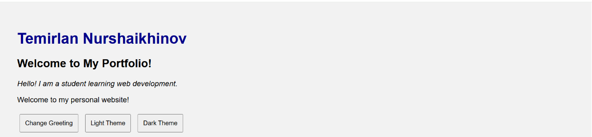
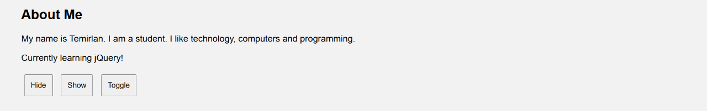
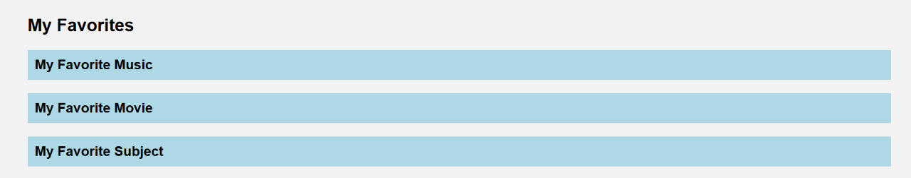
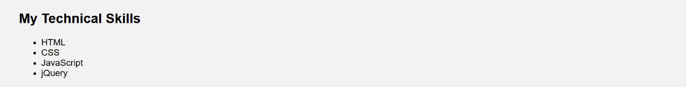
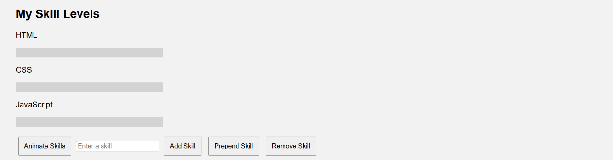

# Assignment 6 – jQuery

**Student:** Temirlan Nurshaikhinov  
**Group:** SE-2539

## Project Description

This project is a personal portfolio website created using HTML, CSS, and jQuery.

## Technologies Used
- HTML
- CSS
- JavaScript
- jQuery

## Completed Tasks

### Task 0 – Setup
- Connected jQuery using CDN.
- Added document ready function.
- Tested jQuery in the console.

### Task 1 – Selectors and CSS
- Used tag, ID, and class selectors.
- Changed text and CSS styles.
- Added Light and Dark themes.

### Task 2 – Visibility Methods
- Used hide(), show(), and toggle().

### Task 3 – Fade Effects
- Used fadeIn(), fadeOut(), and fadeToggle().

### Task 4 – Slide Effects
- Created accordion sections using slideToggle().

### Task 5 – Add and Remove Elements
- Added skills using append() and prepend().
- Removed skills using remove().

### Task 6 – Modifying Attributes
- Changed a website link using attr().

### Task 7 – Form Interaction
- Collected name and email using val().
- Displayed a message using text().

### Task 8 – Animation
- Animated skill bars using animate().

## Conclusion

This assignment helped me practice jQuery selectors, effects, DOM manipulation, form interaction, and animations.

This assignment helped me practice jQuery selectors, effects, DOM manipulation, form interaction, and animations.
